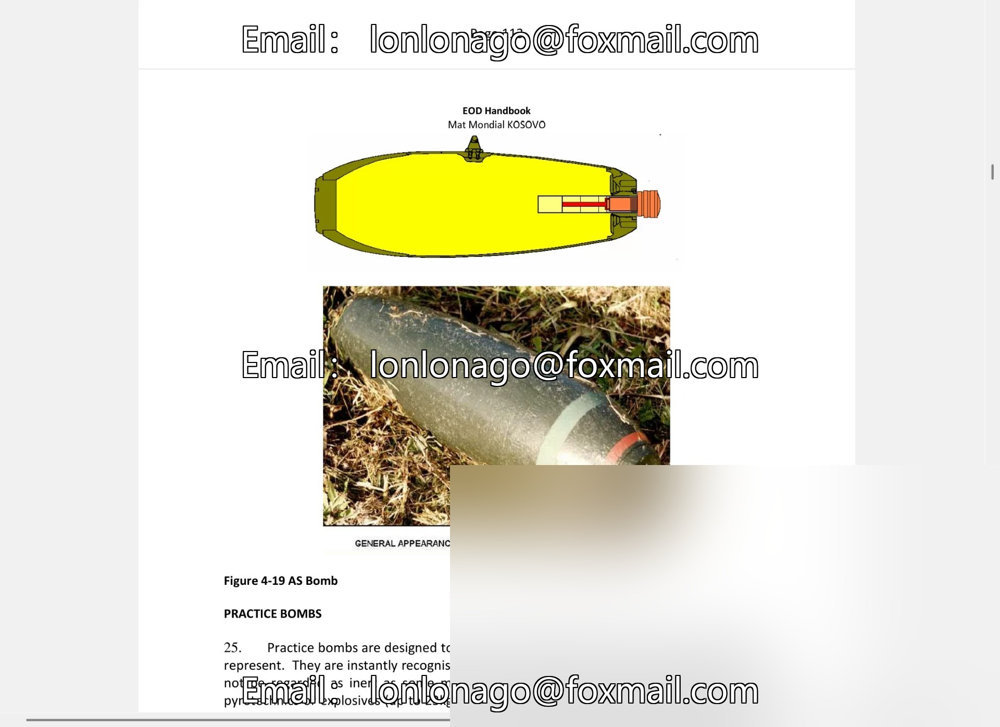
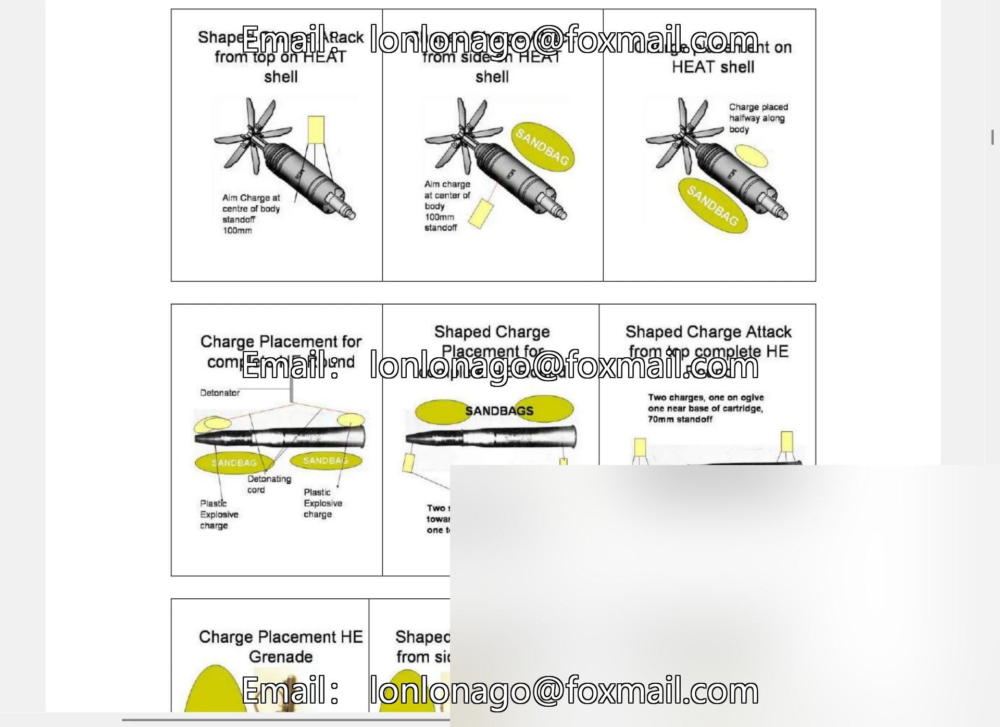
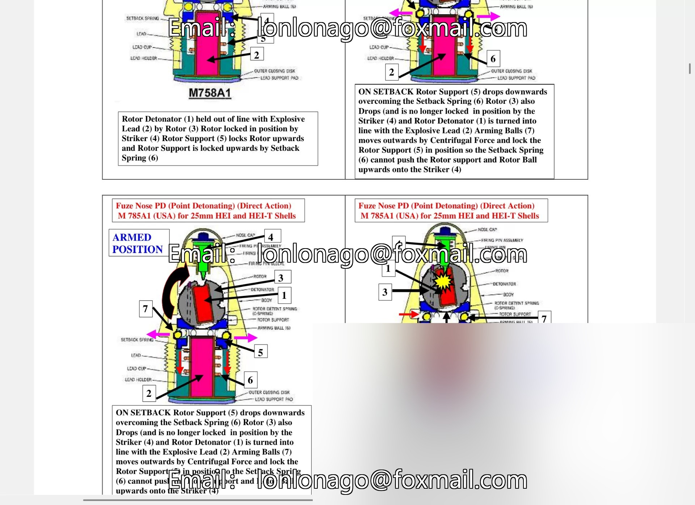
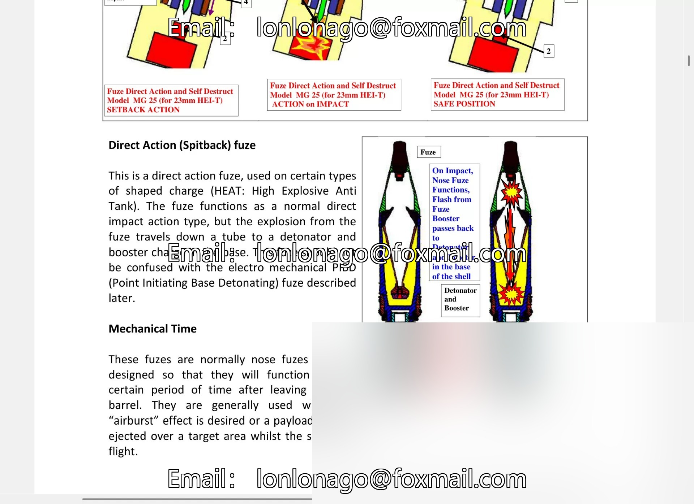
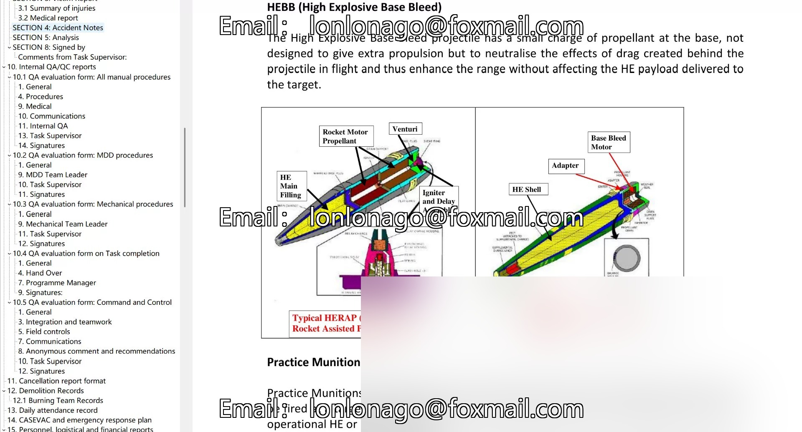
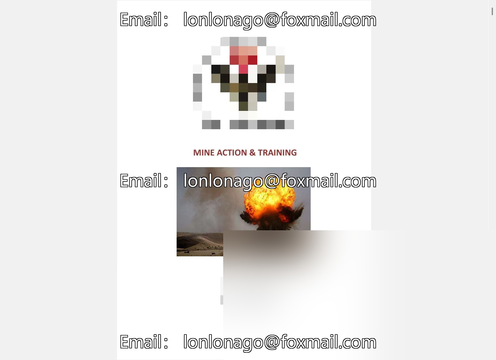

# (Explosive material handling expert) manual, original English , covering explosive material identification

## Body

(Explosive disposal expert) manual English original Content covers explosion device recognition Safety handling Training process, etc. Suitable for anti-terrorism Military and law enforcement personnel EOD professional personnel and military enthusiasts reference for learning.
Approximately 500 pages
Materials include various explosive device identification standards, operation processes, and safety guidelines, with rich images and text, and are highly practical. The can be copied, and it is non-refundable after sale.

No shipping included, self-pickup not supported.

The English original manual covers explosive identification, safety handling, training processes, suitable for counter-terrorism, military police, EOD professionals and military enthusiasts; it includes identification standards, operation processes and safety notes, illustrated with rich visuals and strong practicality; the document spans approximately 500 pages with additional identification standards, operation processes and diagrams.

<!-- AI_ENRICHED -->

## Images

## Payment

Here is a pay link on Stripe ( https://buy.stripe.com/3cs8yP7sY87d0vu9AB ). Please contact me lonlonago@foxmail.com after funding $89, and I will send you a complete data files , thank you!

